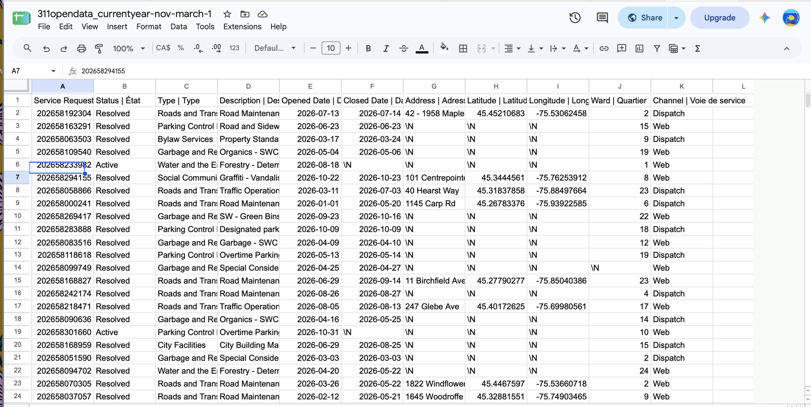
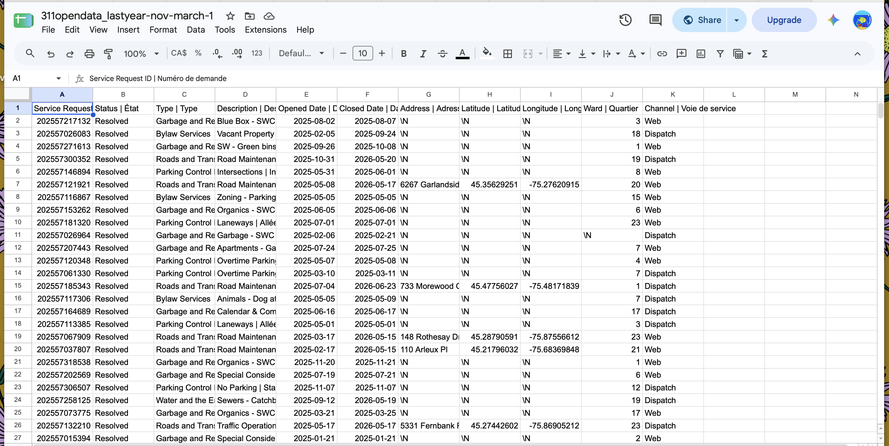
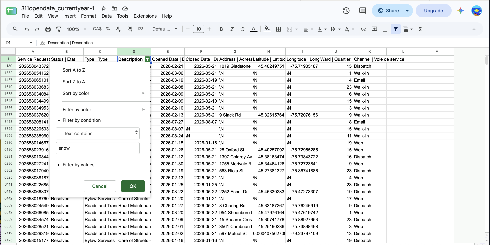
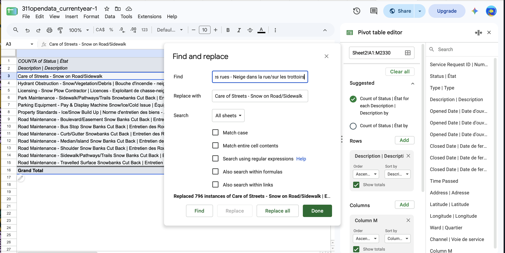
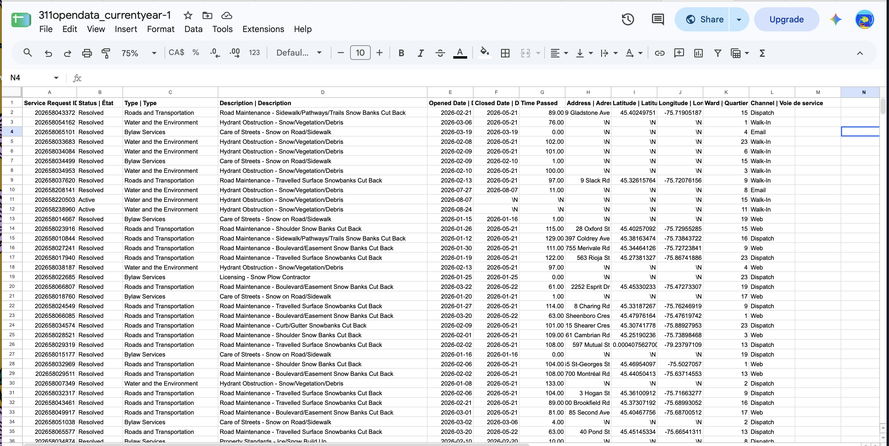
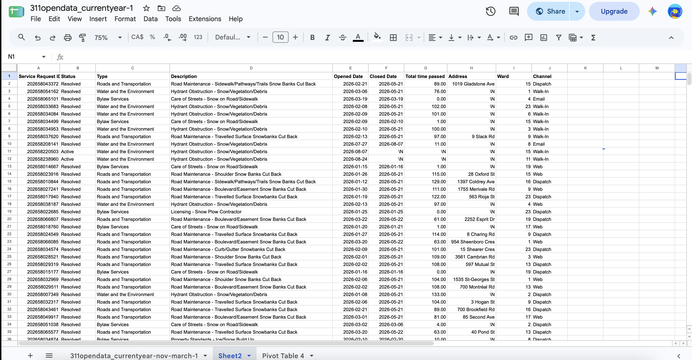
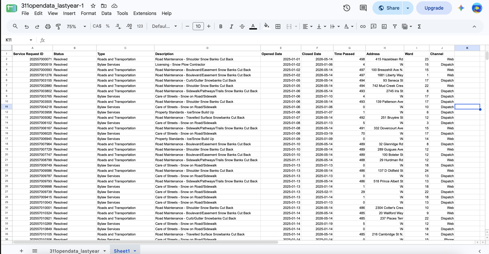
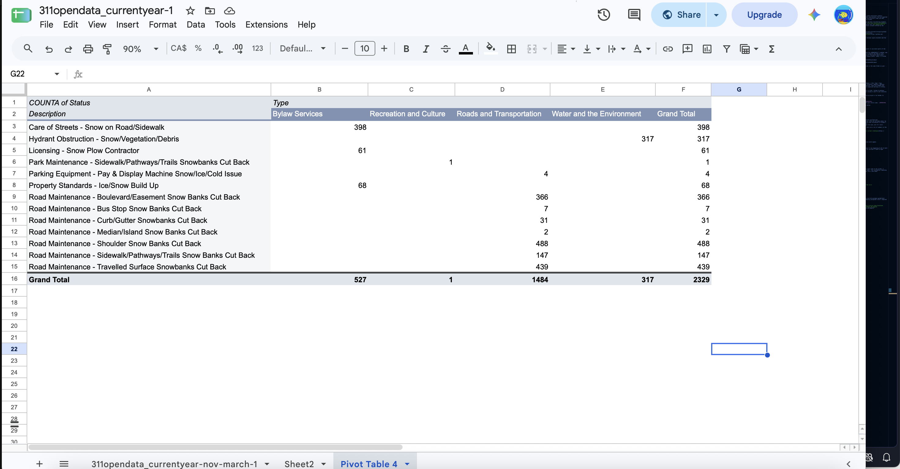
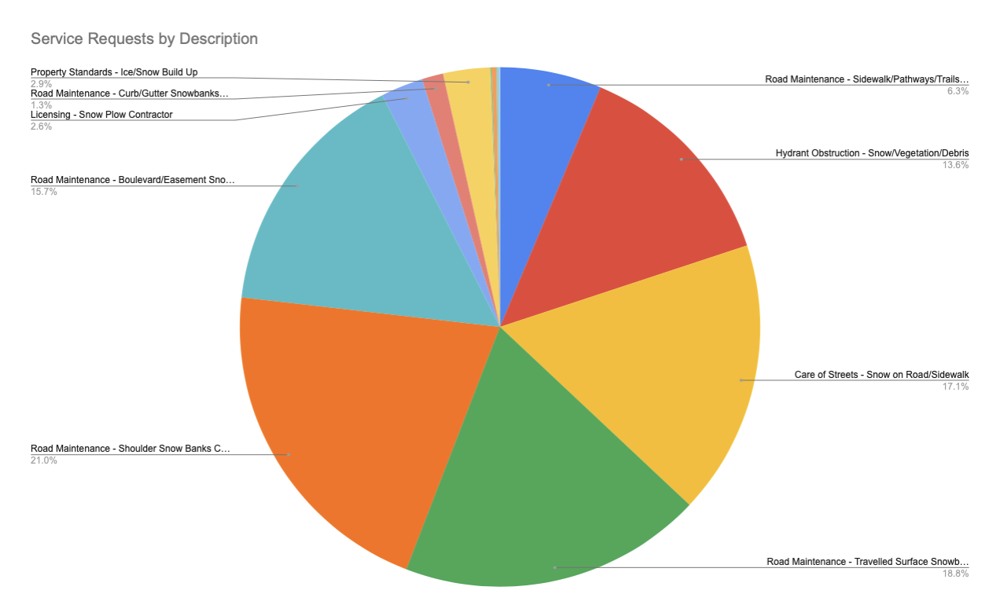
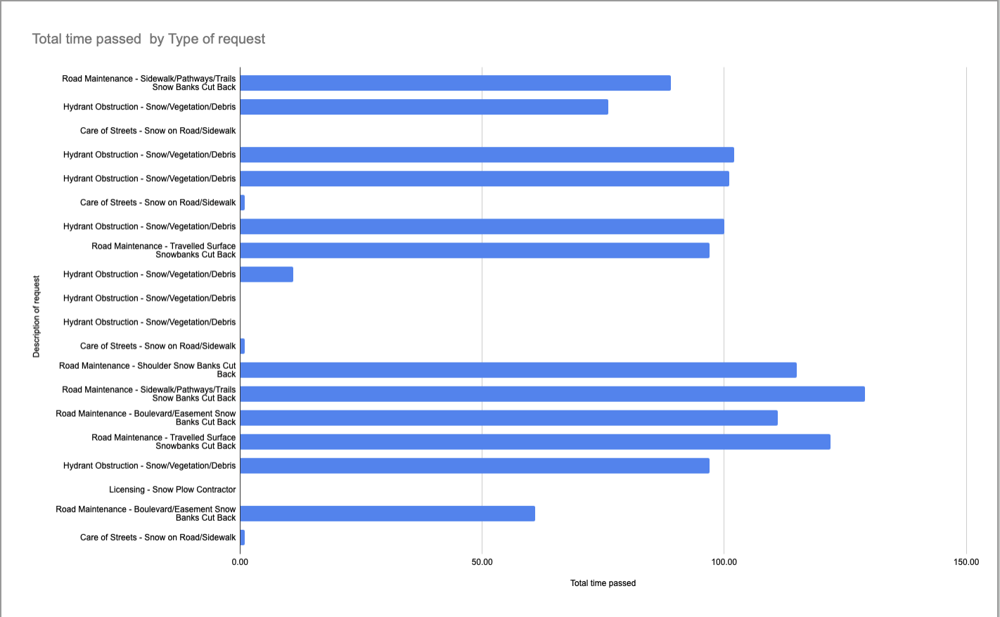

**Nov 1st, 2026** 
**MPAD2003A Introductory Data Storytelling** 
**Andra Popescu** 
**Presented to Jean-Sébastien Marier** 

# Deliverable 2: Exploratory Data Analysis (EDA)
# Ottawa's Snowy Roads

## 1. Getting Data

I will analyze the City of Ottawa dataset that looks at Current Year Service Requests to see which parts of the city have the most difficulty to be accessible during the winter time. 

I have come across problems when importing this dataset into Google Sheets. I used the =IMPORTDATA("") method, and kept getting an error. I then had to just download it and use Numbers on my Mac to organize the data to just display nov-march (wintertime). I did so by clicking organize, filter, then I hid all the months which aren't nov-march , like 2026-09 for example. Then, I downloaded it and imported it into Google Sheets. Sadly, it turned out to be a waste of time as all of it ended up exporting to the spreadsheet.

Link to this year's data: https://open.ottawa.ca/documents/65fe42e2502d442b8a774fd3d954cac5/about

Link to last year's data: https://open.ottawa.ca/documents/87abd7493677492f83295ec56e6a4929/about

To include a screen capture, use the sample code below. Your images should be saved in the same folder as your `.md` file.

 
*Figure 1: The Google Sheets spreadsheet for this year's data.*
 
*Figure 2: The Google Sheets spreadsheet for last year's data.*

Link to this year's spreadsheet: https://docs.google.com/spreadsheets/d/1wNH6fUPj81aFi2rzRp6GTvcugoMNXg1k8KAyp53HXLw/edit?usp=sharing

Link to last year's spreadsheet: https://docs.google.com/spreadsheets/d/1NcuhOlY8AEkwyX7-Ha-xpFqzldZGICvhLdP-LRDAzek/edit?usp=sharing

IMPORTANT: For last year's spreadsheet the data just would not save whenever I edited it, so when reviewing please look at Sheet 1. And for this year's look at Sheet 2.

There are 11 columns for both, titled: Service Request ID | Numéro de demande, Status | État, Type | Type, Description | Description, Opened Date | Date d'ouverture, Closed Date | Date de fermeture, Address | Adresse, Latitude | Latitude, Longitude | Longitude, Ward | Quartier, Channel | Voie de service. There are 372070 rows total in last year's dataset and 316776 rows for this year's dataset. The data is organized and easy to follow, however it is a lot of information and is awfully overwhelming.

Column A contains nominal values since each service request ID is unique, but not in order. Column B contains ordinal variables, with the options being active, resolved, cancelled. I consider columns E and F to be intervals (elapsed time).

Surprising information: a lot of addresses and wards are missing, which will make my project a lot harder to complete.

## 2. Understanding Data

### 2.1. VIMO Analysis

For this section, I will use the data from the current year. 
V-Valid: Column B looks at the status of the demand, in this case it's between Active and Resolved.
I-Invalid: Column G of Total Time Passed contains amounts that are in the negatives, which do not make sense. So that means that the issue was resolved before the issue was reported. There is also some information in column F about closing dates happening this summer which is a bit odd for a winter request. 
M-Missing: A lot of addresses have "\N", it doesn't matter much since we still get the ward, but it's still missing information.
O-Outlier: I'm not seeing any outliers, but I do see that for Total Time Passed there are a lot of numbers in the hundreds.

### 2.2. Cleaning Data

I started by adding a filter on column D so that only jobs that revolve around snow would appear.

 
*Figure 3: Filter the Description column so that text must contain "snow".*

I then removed the French part of the information in description (column D) because it was beginning to be hard to read. I did so by using find and replace while having column stats open so I can see what I need to type.

 
*Figure 4: Replacing bilingual into only English.*

I found these columns irrelevant to my project, so I deleted them.

 
*Figure 5: Deleting the longitude and latitude columns.*

 
*Figure 6: Cleaned up spreadsheet for this year's data.*

 
*Figure 7: Cleaned up spreadsheet for last year's data.*

Other things I did were related to formatting such as moving all the \N's to the right side of the screen. A problem that I came across is that after I got rid of the information excluding "snow", the information remaining stayed in the same row numbers. What I did what I copy and pasted the information into a new sheet.

### 2.3. Analyzing Data

 
*Figure 8: Pivot table showing the total snow related requests that were submitted.*

The pivot table just added all of the requests to see how many requests were for each description, and then the total of snow related requests.

 
*Figure 9: Pie chart showing what type of requests were submitted regarding the snow this year.*

I chose to use the pie chart because I wanted to see clearly which issues demanded the most attention. In this case, Snow Banks demand the most (if you add the 2 highest % together since they both are about snowbanks).

 
*Figure 10: Bar chart displaying request descriptions by the amount of days it took to complete them*

This bar chart contains the most important data, it shows which issues took the longest to complete. Looking at the data, it is obvious that there is something wrong. It should not have taken them more than a week to complete these requests, yet some of them surpass 7 days. It seems that snow on roads/sidewalks is the one they take of the fastest (days).

## 3. Delivering Data

To tell this story I would need an explanation on why the days are so inconsistent. Why are some in the negatives, some in the hundreds? 

I think I will have to reach out the team that put together the data at opendata@ottawa.ca, or email 311@ottawa.ca. I think I would be able to get a hold of someone who could explain the data better for me.

For the interview I'd like to stay on track with my "mission" and reach out to the Snow Moles I talked about in my story pitch! They would speak from experience and they'd be able to give me some insight on what the data means as well.

## 4. References

Include a list of your references here. Please follow [APA](https://apastyle.apa.org/style-grammar-guidelines/references) or [MLA](https://www.mla.org/MLA-Style) guidelines for references. Hanging paragraphs aren't required though.

**Here's an example:**

Bounegru, L., & Gray, J. (Eds.). (2021). *The Data Journalism Handbook 2: Towards A Critical Data Practice*. Amsterdam University Press. [https://ocul-crl.primo.exlibrisgroup.com/permalink/01OCUL_CRL/hgdufh/alma991022890087305153](https://ocul-crl.primo.exlibrisgroup.com/permalink/01OCUL_CRL/hgdufh/alma991022890087305153)
